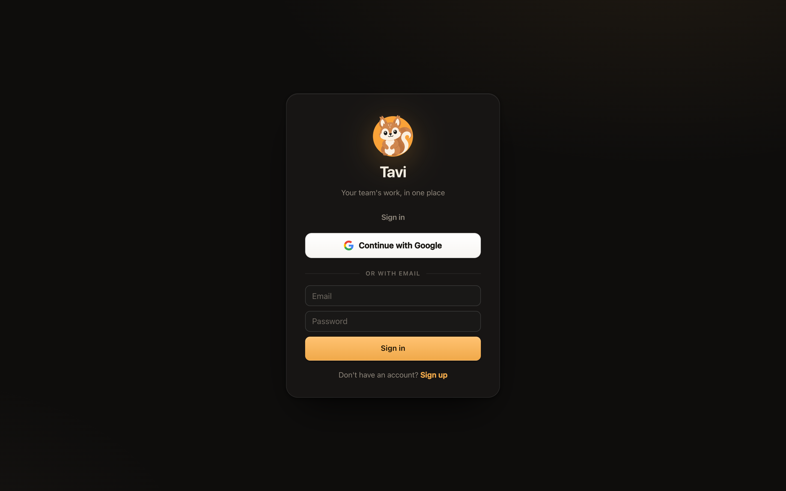
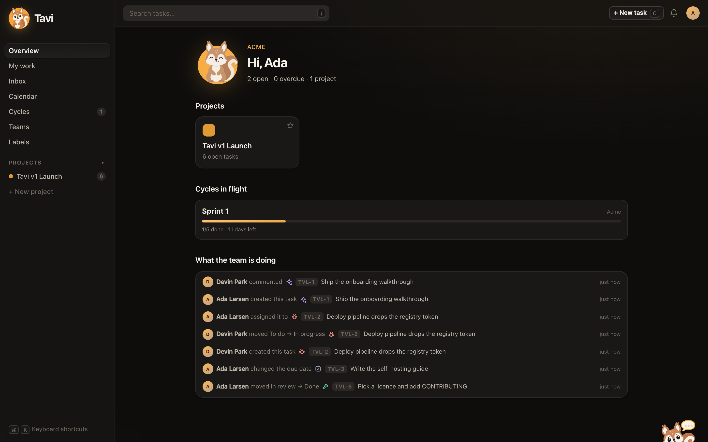
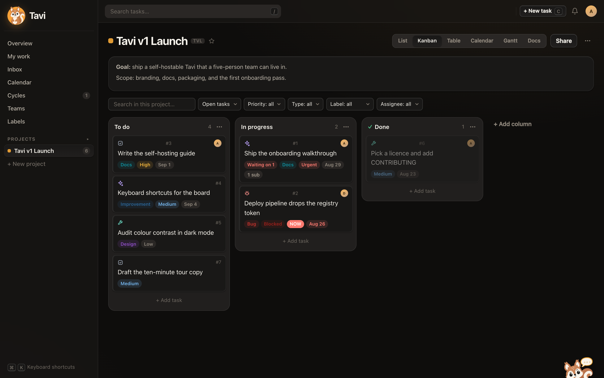
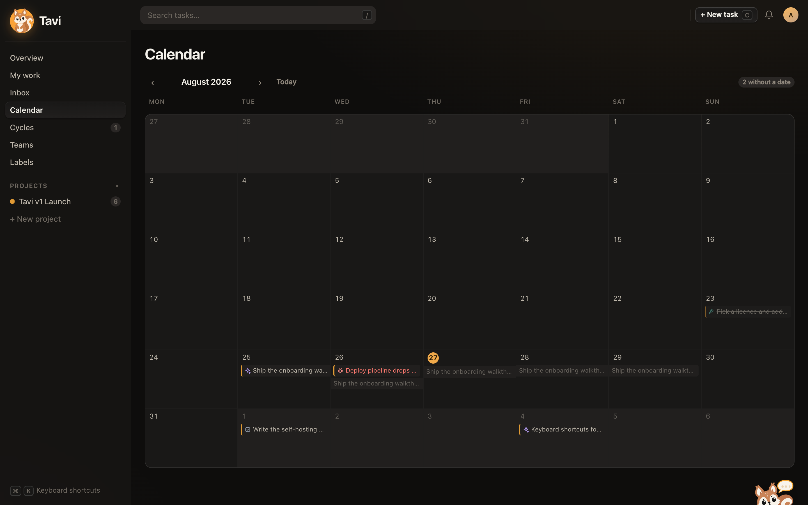
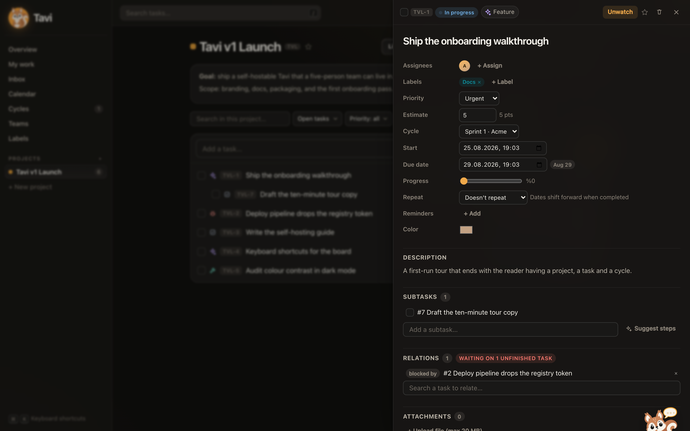
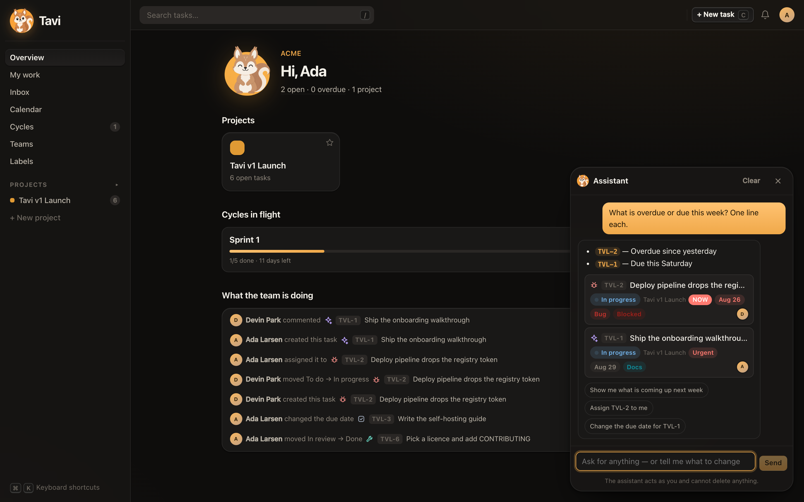

<div align="center">


# Tavi

**Open-source, self-hosted task tracking for small teams.**

Projects, cycles, docs and an inbox — on your own server, in one Docker command.

[](https://github.com/devfurkankizmaz/tavi-app/actions/workflows/ci.yml)
[](LICENSE)
[](.nvmrc)

[Quick start](#quick-start) · [What it does](#what-it-does) · [Configuration](#configuration) · [Integrating](#integrating-with-it) · [Contributing](CONTRIBUTING.md)

</div>

---

Tavi is a task tracker for a team of two to twenty people who want their work,
their specs and their conversations in one place they control. It runs on a
small VPS, keeps everything in one Postgres database, and has no hosted tier you
are being funnelled towards.

It is deliberately not an enterprise tool. There is no portfolio roll-up, no
resource forecasting, no per-seat billing to work around.

## Quick start

You need Docker and about two minutes.

```bash
git clone https://github.com/devfurkankizmaz/tavi-app.git
cd tavi-app
cp .env.prod.example .env.prod
```

Open `.env.prod` and set two values — everything else has a working default:

| Variable | What to put there |
| --- | --- |
| `JWT_SECRET` | Any long random string. `openssl rand -base64 48` will do. |
| `PUBLIC_ORIGIN` | Where people will reach it, e.g. `https://tavi.example.com` |

Then:

```bash
docker compose -f docker-compose.prod.yml --env-file .env.prod up -d
```

That is the whole install. Migrations run on boot. Open `PUBLIC_ORIGIN`, create
the first account, and you have a working tracker.



The sign-in screen follows your configuration: the Google button appears only
once `GOOGLE_CLIENT_ID` is set, and the sign-up link disappears with
`REGISTRATION_ENABLED=0`.

<details>
<summary><b>Running it locally instead, for development</b></summary>

```bash
npm install
cp .env.example .env          # DATABASE_URL and JWT_SECRET are all that is required
docker compose up -d db       # or point DATABASE_URL at a Postgres you already run
npm run db:migrate
npm run db:seed               # sample project, tasks, a cycle and a doc
npm run dev                   # API on :3457, web on :5173
```

Sign in as `ada@tavi.local` / `tavi-demo-1234`, or set `DEV_LOGIN=1` for
one-click access without a password.

</details>



## What it does

**Work is organised the way a small team actually works.** Tasks live in
projects, and every project has a short key so its tasks get readable ids —
`TAV-12`, not `#4471`. A task carries a kind (feature, bug, task, chore), a
status, priority, estimate, dates, labels, assignees, subtasks, relations,
comments, files and reminders. Cycles are the sprints; they belong to a team, so
one cycle can pull work from several projects.

**Six ways to look at the same work.** List, kanban, table, calendar, gantt and
docs — per project, plus one calendar across all of them. Work with a start and
a due date stretches across the calendar as a bar, and dragging it moves the
deadline.

<p align="center">
  
  
</p>

**Blocking means something.** A task waiting on another shows it in every list
and board. Completing blocked work asks first rather than going through
silently, and when the last blocker clears, whoever is watching hears about it.

**Three screens, three questions.** Overview: what is happening in the
workspace. Inbox: what changed while you were away, grouped by task, with
archive as a state separate from read. My work: what is on your own plate,
grouped by when it is due.

**Filters that can be handed to someone.** Every filter and the chosen view
live in the URL, so a filtered board survives a reload and the address bar is
something you can paste into a chat. Name one and it becomes a saved view —
yours, or shared with everyone on the project.

**Search that reaches the content.** Postgres full-text across task titles and
descriptions, documents and comments — ranked, with the matching passage
highlighted.

**Notifications you can turn down instead of off.** Each kind of event has its
own two switches — inbox and email — and a daily digest that gathers whatever
is still unread into one message. The digest is independent of the switches,
so the common setting (no immediate mail, one summary in the morning) is two
clicks rather than a compromise.

**Nothing is deleted in anger.** Deleting a task, doc or project moves it to
trash with an Undo toast and keeps it recoverable for 30 days.



**An assistant, only if you want one.** Plug in an Anthropic or Gemini key and a
chat bubble appears that can search, create, update, assign, comment and write
docs — always with your own permissions, never more. Outside the chat it offers
to break a task into steps, catch you up on a long thread, or draft a cycle
update; those only ever suggest, and you apply. Leave the key empty and none of
it exists: no bubble, no endpoint, no cost.



**Made to be lived in.** Command palette on <kbd>⌘</kbd><kbd>K</kbd>, keyboard
shortcuts throughout, a real mobile layout with bottom navigation and sheets,
Slack notifications, email with links that open the task itself, an ICS calendar
feed, JSON export, and API tokens for whatever you want to wire up.

## Your first ten minutes

1. **Sign in.** With `REGISTRATION_ENABLED=1` you can create an account, or use Google.
2. **Create a project.** It gets a key like `TAV`, so its tasks become `TAV-1`, `TAV-2`.
3. **Add a few tasks.** Press <kbd>C</kbd> anywhere for quick add.
4. **Create a team** and invite colleagues by email. They accept from their own Overview.
5. **Share the project with the team** so everyone can see it.
6. **Start a cycle**, give it a goal and two weeks, and pull tasks in.
7. **Work the board.** Drag between columns; the workload panel shows who is on what.
8. **Write the spec.** Open the project's Docs tab and link the tasks it covers.
9. **Connect Slack** from Teams, so activity lands where the team already talks.
10. Press <kbd>⌘</kbd><kbd>K</kbd> — everything is reachable from there. <kbd>?</kbd> lists every shortcut.

## Configuration

Everything is environment variables. `.env.example` and `.env.prod.example` are
fully commented; these are the ones that matter.

### Required

| Variable | Notes |
| --- | --- |
| `DATABASE_URL` | Postgres connection string |
| `JWT_SECRET` | Long random string. Changing it signs everyone out. |
| `PUBLIC_ORIGIN` | Public URL; used in emails and OAuth redirects |

### Sign-in

`REGISTRATION_ENABLED=0` makes the instance invite-only. For Google, create an
OAuth client at [console.cloud.google.com](https://console.cloud.google.com)
with `${PUBLIC_ORIGIN}/auth/google/callback` as the redirect, then set
`GOOGLE_CLIENT_ID` and `GOOGLE_CLIENT_SECRET`. Leave them empty and the Google
button never appears. `DEV_LOGIN=1` enables passwordless local sign-in and must
stay off in production.

### Email

Set `SMTP_HOST`, `SMTP_PORT`, `SMTP_USER`, `SMTP_PASS` and `SMTP_FROM`. Leave
`SMTP_HOST` empty and email is skipped silently while in-app notifications keep
working. Gmail and Workspace use `smtp.gmail.com:587` with an app password;
Postmark and Resend also work as plain SMTP.

Notification emails carry the task key, its due date and priority, and a button
that opens the task. If the recipient is signed out they land on it right after
signing in, not on a generic home page.

### Slack

Create a Slack app, add an **Incoming Webhook**, pick a channel, copy the URL,
then paste it in **Teams → your team → Slack**. Tavi posts a confirmation to the
channel; a wrong URL is rejected rather than saved quietly.

### Assistant

Optional. Set one key and it turns on:

| Provider | Key | Default model |
| --- | --- | --- |
| Anthropic | `AGENT_API_KEY` | `claude-opus-5` |
| Google Gemini | `GEMINI_API_KEY` | `gemini-3.1-pro-preview` |

Whichever key is set is the one used; with both set, `AGENT_PROVIDER` decides.
Override the model with `AGENT_MODEL`, or `GEMINI_MODEL` for Gemini.

Every action runs as the signed-in user, so the assistant can never see or touch
a project that person could not open themselves. It has no delete tools at all.
Four limits bound a single request — `AGENT_MAX_STEPS` (8), `AGENT_MAX_WRITES`
(20), `AGENT_MAX_BULK` (20) and `AGENT_TIMEOUT_MS` (90000) — and chat is capped
at 40 requests per 10 minutes per user. **Settings → Assistant** shows every one
of those numbers, so a team can see exactly what it allowed.

The key stays in the server environment. It is never written to the database and
never sent to the browser.

## Integrating with it

**API tokens.** Create one under **Settings → API tokens** and send it as
`Authorization: Bearer <token>`. It carries exactly the permissions of the
person who made it. The plaintext token is shown once, at creation, and stored
only as a SHA-256 hash.

```bash
curl -H "Authorization: Bearer $TAVI_TOKEN" \
  'https://tavi.example.com/api/tasks?assignee=me&done=false'

curl -H "Authorization: Bearer $TAVI_TOKEN" -H 'Content-Type: application/json' \
  -d '{"title":"Deploy failed on main","type":"BUG","priority":4}' \
  "https://tavi.example.com/api/projects/$PROJECT_ID/tasks"
```

Endpoints worth knowing:

| Endpoint | What it gives you |
| --- | --- |
| `GET /api/tasks` | Filter by `projectId`, `status`, `type`, `assignee=me`, `labelId`, `cycleId`, `dueFrom`, `dueTo`, `q` |
| `POST /api/projects/:id/tasks` | Create a task |
| `PATCH /api/tasks/:id` | Update any field |
| `GET /api/search?q=` | Full-text across tasks, docs and comments |
| `GET /api/inbox` | Grouped notifications |
| `GET /api/activity` | Recent activity across every project you can see |
| `GET /api/views` | Saved views; `POST` to add one, `DELETE /api/views/:id` to remove it |
| `POST /api/import` | Load an export back into your account |
| `PUT /api/me/notifications` | Per-type notification preferences and the digest hour |
| `GET /api/export` | Everything you can see, as JSON |

**Calendar feed.** **Settings → Calendar subscription** gives a private ICS URL
that Google Calendar and Apple Calendar can subscribe to.

**Export and import.** `GET /api/export` returns everything you can see as
JSON — projects, tasks, documents, comments, labels and blocking relations.
`POST /api/import` reads that file back, under **Settings → Import** or
directly. Everything imported belongs to the person importing: no ownership or
permission travels with the file, so it never has to be trusted. Ids in the
file are remapped, which means importing twice makes a second copy rather than
merging. Importers for Trello, Jira and Vikunja would be a welcome
contribution.

## Architecture

npm workspaces monorepo, no build step on the server.

```
apps/api    Express 4 + Prisma 6 + PostgreSQL, run through tsx
apps/web    Vite 6 + React 18 + react-router
```

| Concern | Where it lives |
| --- | --- |
| Authorisation | `apps/api/src/access.ts` — one place decides who sees what |
| Task change → activity, notifications, Slack | `apps/api/src/activity.ts` |
| Assistant | `apps/api/src/agent/` — provider abstraction, tools, bounded loop |
| User-facing strings | `apps/web/src/i18n.tsx`, `apps/api/src/i18n.ts` |
| Design tokens | top of `apps/web/src/styles.css` |

Uploads go to `UPLOAD_DIR` — a Docker volume in production — not the database.

## Development

```bash
npm run dev          # api + web together
npm run check        # typecheck both workspaces
npm run db:migrate   # apply migrations
npm run db:seed      # sample data; -- --reset rebuilds it
npm run regression   # end-to-end tests against a running API
npm run screenshots  # regenerate the images in docs/screenshots
```

`npm run regression` runs 184 checks as four different users — owner, editor,
viewer and a complete outsider — trying every feature from both directions: that
it works, and that it refuses the people it should refuse. Everything it creates
is removed afterwards. CI runs it against a real Postgres on every pull request,
alongside typechecks and a production image build.

## Roadmap

Worth building next, roughly by how much it would help a team:

- Cycle reporting: burndown and velocity, so a cycle can say how it went
- Import from Trello, Jira or Vikunja, not only from Tavi's own export
- GitHub and GitLab linking: a pull request that moves its task
- Project and checklist templates for work that repeats

## Contributing

See [CONTRIBUTING.md](CONTRIBUTING.md), and the
[Code of Conduct](CODE_OF_CONDUCT.md) that participation is held to. Security
reports go through [SECURITY.md](SECURITY.md), not public issues.

## Licence

[MIT](LICENSE).
